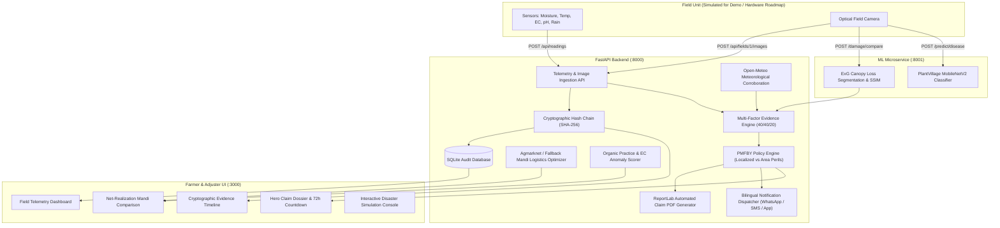

# FasalSakshi (फसलसाक्षी) 🌾
### Automated Crop Evidence, Insurance Claim Dossier & Market Realization Engine

> **One-Line Pitch:** A smart field unit and intelligence layer that monitors crops daily, builds a tamper-proof cryptographic evidence chain of ground reality, and automates PMFBY insurance claims while unlocking premium market realization for farmers.

[](https://github.com/preyanshw29/CluelessCoders_HackShift)
[](LICENSE)
[](https://fastapi.tiangolo.com)
[](https://nextjs.org)

---

## 📌 Honest Engineering Framing

To maintain complete transparency with judges and evaluators, our project boundaries are explicitly defined:

| Category | Component & Scope |
|---|---|
| **Built (Real & Functional)** | Next.js 14 Web Application, SHA-256 cryptographic image hash chain vault, Open-Meteo live weather radar triggers, multi-factor confidence scoring (40% Weather / 40% Vision / 20% Ground Sensors), PMFBY policy evaluation engine with 72h countdown, automated insurer-grade PDF report generator, bilingual (Hindi/English) alerts, mandi transport cost optimizer, and organic practice evidence scorer. |
| **Simulated (Clearly Labelled)** | Real-time sensor feed (Python streaming CLI + dashboard scenario triggers) and mock weather profiles to ensure repeatable, deterministic disaster testing during live demonstrations. |
| **Roadmap (Designed, Not Built)** | Physical ruggedized field hardware unit: optical wide-angle camera + soil moisture, temperature, electrical conductivity (EC), pH, and rainfall bucket. *Rationale: Sensors are off-the-shelf and commoditized; our innovation and core defensibility lies in the data integrity layer, multi-modal evidence engine, and automated claim settlement.* |

> **Compliance & Legal Notice:**
> 1. **Organic Score:** Reflects "evidence strength based on logged practices and soil EC stability", **not** government NPOP / PGS-India certification.
> 2. **Claim Payout Estimates:** Indicative bounds based on sample PMFBY guidelines; final claim admissibility and indemnities are determined by the authorized insurer and state notification rules.
> 3. **Machine Learning:** Disease classification is trained on open datasets (e.g., PlantVillage); expected accuracy on complex outdoor field images is lower than controlled lab settings.

---

## 🏗️ System Architecture



---

## 🚀 Quick Start & Setup

### Prerequisites
- Python 3.11+ (or 3.12+)
- Node.js 18+ / 20+ and npm

### 1. Clone & Configure Environment
```bash
git clone https://github.com/preyanshw29/CluelessCoders_HackShift.git
cd CluelessCoders_HackShift

# Copy sample configuration
cp .env.example .env
```

### 2. Run ML Microservice (Port 8001, Optional / Standalone)
```bash
cd ml-service
pip install -r requirements.txt
python run.py
```
* ML Health check: `curl http://localhost:8001/health`

### 3. Run Backend (Port 8000)
```bash
cd ../backend
pip install -r requirements.txt -r requirements-m4.txt

# Start backend server
python -m uvicorn app.main:app --host 0.0.0.0 --port 8000 --reload
```
* Interactive API Documentation (Swagger): [http://localhost:8000/docs](http://localhost:8000/docs)
* Health check: `curl http://localhost:8000/api/health`

### 4. Run Frontend (Port 3000)
```bash
cd ../frontend-simulation/frontend
npm install
npm run dev
```
* Farmer Web Application: [http://localhost:3000](http://localhost:3000)

### 5. Run Verification & Test Suites
```bash
# Run Member 4 unit tests
python -m pytest backend/tests/test_m4.py

# Run End-to-End System Smoke Test
python scripts/smoke_test.py
```

---

## 📡 API Endpoints Overview

### ML Microservice (Member 1 — Port 8001)
* `GET /health`: Service health and model version registry.
* `POST /predict/disease`: MobileNetV2 crop pathology diagnostics with top-3 predictions.
* `POST /damage/compare`: Bitemporal ExG canopy segmentation, SSIM loss analysis, and heatmap.

### Core Backend & Evidence Vault (Member 2 — Port 8000)
* `GET /api/health`: Backend health status.
* `GET /api/fields`, `GET /api/fields/{id}`: Farm and farmer details.
* `POST /api/readings`: Stream sensor telemetry.
* `GET /api/fields/{id}/readings`: Historic sensor readings (limit 200).
* `POST /api/fields/{id}/images`: Ingest field photo into SHA-256 hash chain.
* `GET /api/fields/{id}/chain/verify`: Verify complete cryptographic head hash.
* `POST /api/simulate/{scenario}`: Trigger simulated climate shock (`hail`, `flood`, `drought`, `frost`, `fertilizer_spike`).
* `POST /api/fields/{id}/check-weather`: Trigger live Open-Meteo satellite weather check.

### Reports, Alerts, Market & Organic (Member 4 — Port 8000)
* `GET /api/claims/{id}/report.pdf`: Download insurer-admissible PDF claim dossier.
* `GET /api/fields/{id}/alerts`: Fetch recent alerts (English / Hindi).
* `POST /api/alerts/test`: Dispatch sample WhatsApp / App alert.
* `GET /api/market/prices`: Real-time / fallback mandi prices for commodities.
* `GET /api/market/best`: Calculate net price per quintal after deducting road transport logistics (`₹0.25/qtl/km`).
* `POST /api/fields/{id}/inputs`: Log chemical or organic farm input (neem spray, vermicompost, urea).
* `GET /api/fields/{id}/inputs`: View complete cultivation input log.
* `GET /api/fields/{id}/trust-score`: Calculate Organic Evidence Score (0–100) with anomaly deduction flags.

---

## 👥 Team & Ownership (HackShift: CluelessCoders)

| Member | Role | Key Contributions |
|---|---|---|
| **Member 1** | ML Engineer | `ml/`, `demo_assets/` — Disease detection & visual canopy loss comparison model |
| **Member 2** | Backend & Policy Engine | `backend/app/db.py`, `hashchain.py`, `pipeline.py`, `policy_engine.py`, `scoring.py`, `schema.sql` |
| **Member 3** | Frontend & Sensor Simulator | `frontend-simulation/` — Next.js 14 App Router, Recharts telemetry curves, sensor simulator CLI |
| **Member 4** | Reporting, Alerts & Market | `backend/app/report.py` (PDF Dossier), `alerts.py` (Twilio/WhatsApp), `market.py`, `seed_organic.py`, `docs/`, `README.md` |

---

## 📄 Documentation Links
* [REST API Reference & OpenAPI Specification](docs/api_reference.md)
* [Pitch Presentation Outline & Slide Deck](docs/pitch_outline.md)
* [3-Minute Timed Demonstration Script](docs/demo_script.md)
* [Judge Q&A & Technical Defense Guide](docs/judge_qa.md)