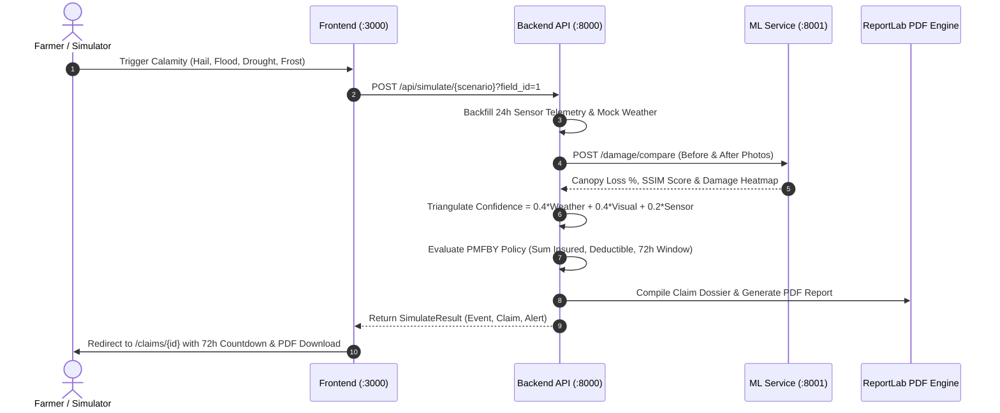
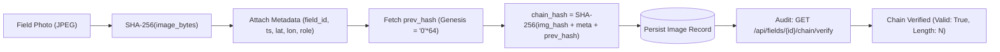
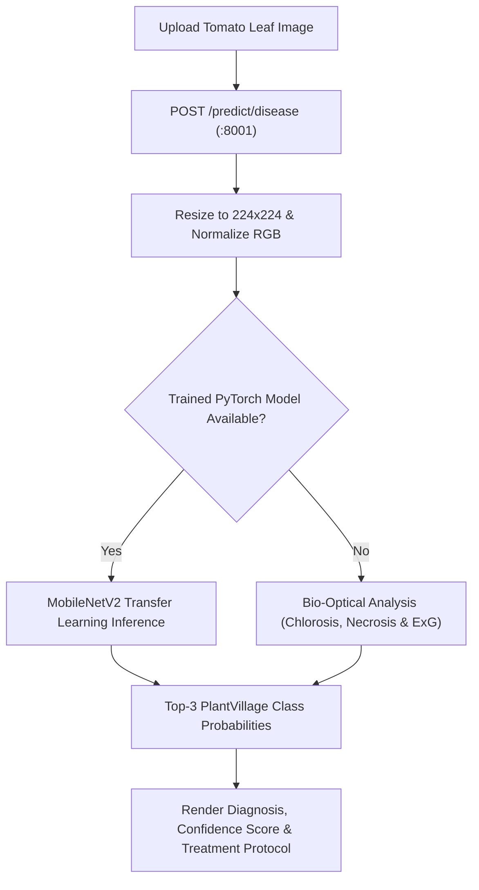
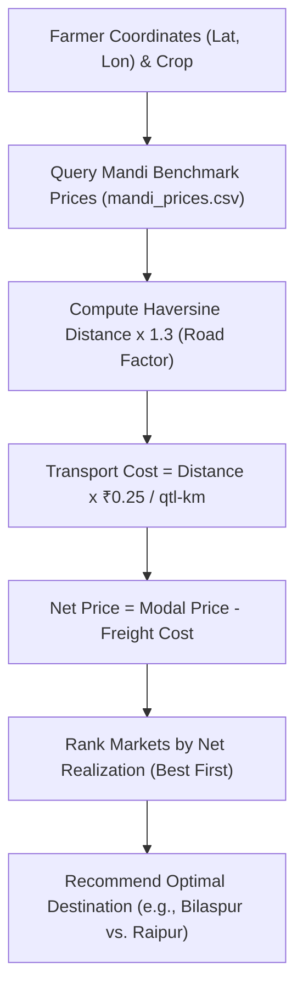

# FasalSakshi (फसलसाक्षी) 🌾
### Automated Crop Evidence, Insurance Claim Dossier & Market Realization Engine

> **One-Line Pitch:** A field-level intelligence platform that watches crops daily, builds a tamper-proof cryptographic evidence chain of ground reality, automates PMFBY crop insurance claims within 72 hours, and empowers farmers with net-profit mandi optimization and crop pathology diagnostics.

[](https://github.com/preyanshw29/CluelessCoders_HackShift)
[](LICENSE)
[](https://fastapi.tiangolo.com)
[](https://nextjs.org)
[](https://pytorch.org)

---

## 📌 Honest Engineering Framing

To maintain complete transparency with judges and evaluators, our project boundaries are explicitly defined:

| Category | Component & Scope |
|---|---|
| **Built (Real & Functional)** | Next.js 14 Web Application (7 complete views), SHA-256 cryptographic image hash-chain vault, Open-Meteo meteorological corroboration, 3-signal confidence fusion (40% Weather / 40% Visual / 20% Ground Sensors), PMFBY policy evaluation engine with 72-hour filing deadline countdown, automated ReportLab PDF evidence generator, bilingual (Hindi/English) alerts, Agmarknet/CSV mandi transport cost optimizer, organic cultivation trust scorer, and MobileNetV2 plant pathology diagnostic engine. |
| **Simulated (Clearly Labelled)** | IoT sensor telemetry streamer (`simulate.py` CLI + demo panel buttons) and calibrated calamity weather profiles (`contracts/scenario_profiles.json`) to ensure repeatable, deterministic disaster testing during live demonstrations. |
| **Roadmap (Designed, Not Built)** | Physical ruggedized field hardware unit: optical wide-angle camera + soil moisture, temperature, electrical conductivity (EC), pH, and rainfall bucket. *Rationale: Sensors are off-the-shelf commoditized hardware; our innovation lies in the data integrity layer, multi-modal evidence engine, and automated claim settlement.* |

> **Compliance & Legal Notice:**
> 1. **Organic Score:** Reflects evidence strength based on logged farm inputs and soil EC stability; it is **not** official government NPOP / PGS-India certification.
> 2. **Claim Payout Estimates:** Indicative bounds based on sample PMFBY guidelines; final claim admissibility and indemnities are determined by the authorized insurer and state notification rules.
> 3. **Machine Learning:** Disease classification is trained on open datasets (PlantVillage); expected accuracy on complex outdoor field images is lower than controlled lab settings.

---

## 🏗️ System Architecture

```mermaid
flowchart TD
    subgraph DataSources["1. Data Ingestion & Field Capture"]
        Sensors["IoT Sensors (Soil Moisture, Temp, EC, pH, Rain)"]
        Camera["Field Imagery (Baseline, Routine, Before, After)"]
        WeatherLive["Open-Meteo Meteorological Radar"]
    end

    subgraph MLService["2. ML & Computer Vision Microservice (:8001)"]
        DiseaseModel["MobileNetV2 Plant Pathology Engine"]
        CanopyExG["ExG Canopy Loss Segmentation (2G-R-B)"]
        SSIMHeatmap["SSIM Structural Shift Heatmap Generator"]
    end

    subgraph BackendCore["3. FastAPI Backend Core (:8000)"]
        IngestAPI["Telemetry & Image Ingestion API"]
        HashVault["SHA-256 Cryptographic Photo Blockchain"]
        Triangulation["3-Signal Triangulation Engine (40/40/20)"]
        PolicyEngine["PMFBY Policy Evaluator & Loss Bounds"]
        PDFGen["ReportLab Evidence PDF Dossier Generator"]
        AlertService["Bilingual Dispatcher (WhatsApp / SMS / App)"]
        MandiEngine["Mandi Net Realization Logistics Optimizer"]
        OrganicEngine["Organic Trust Score & EC Anomaly Auditor"]
        DB[(SQLite 3 Database: fasalsakshi.db)]
    end

    subgraph FrontendApp["4. Next.js 14 Web Application (:3000)"]
        UI_Dash["Dashboard (Overview & PMFBY Status)"]
        UI_Sensors["Live Sensor Graphs (/fields/1)"]
        UI_Vault["Cryptographic Evidence Timeline (/fields/1/evidence)"]
        UI_Claim["Claim Dossier & 72h Countdown (/claims/1)"]
        UI_Market["Mandi Realization & Trust Score (/market)"]
        UI_Sim["Interactive Disaster Console (/simulate)"]
        UI_Doctor["Crop Doctor AI Diagnostics (/disease)"]
    end

    Sensors -->|POST /api/readings| IngestAPI
    Camera -->|POST /api/fields/{id}/images| IngestAPI
    Camera -->|POST /damage/compare| CanopyExG
    Camera -->|POST /predict/disease| DiseaseModel
    IngestAPI --> HashVault
    HashVault --> DB
    WeatherLive --> Triangulation
    CanopyExG --> Triangulation
    IngestAPI --> Triangulation
    Triangulation --> PolicyEngine
    PolicyEngine --> PDFGen
    PolicyEngine --> AlertService
    MandiEngine --> UI_Market
    OrganicEngine --> UI_Market
    DB --> UI_Dash
    PolicyEngine --> UI_Claim
    HashVault --> UI_Vault
    DiseaseModel --> UI_Doctor
```

---

## 🔄 Core Workflows

### Workflow 1: Calamity Detection & Automated Claim Dossier Generation
When severe weather strikes, FasalSakshi fuses three independent signals to establish verifiable ground reality:



---

### Workflow 2: Tamper-Evident Photo Blockchain Audit
Every farm image uploaded is cryptographically anchored to prevent retrofitted insurance fraud:



---

### Workflow 3: Crop Doctor AI Plant Pathology Diagnostic
Farmers upload leaf photographs to receive real-time disease identification and organic treatment protocols:



---

### Workflow 4: Mandi Logistics & Net Price Realization
Helps farmers choose the most profitable wholesale market by factoring in freight transport costs:



---

## ⚡ 1-Click Launch & Quick Start

### Option A: 1-Click Windows Launcher (Fastest)
From the project root folder, double-click or run:
```cmd
run_all.bat
```
*Or using PowerShell:*
```powershell
.\scripts\run_all.ps1
```
*(This automatically opens 3 dedicated terminal windows for the ML Service, Backend API, and Frontend Website).*

---

### Option B: Manual Service-by-Service Launch

#### 1. Start ML Microservice (Port 8001)
```powershell
cd ml-service
python run.py
```
* Interactive Docs: [http://localhost:8001/docs](http://localhost:8001/docs)

#### 2. Start Backend Core API (Port 8000)
```powershell
cd backend
python -m uvicorn app.main:app --port 8000 --reload
```
* Interactive Docs: [http://localhost:8000/docs](http://localhost:8000/docs)

#### 3. Start Next.js Frontend (Port 3000)
```powershell
cd frontend-simulation/frontend
npm run dev
```
* Farmer Web Application: [http://localhost:3000](http://localhost:3000)

---

## 🧪 Automated Testing & Verification

Run the end-to-end integration test suites:
```powershell
# 1. Full 9-Point System Smoke Test
python scripts/smoke_test.py

# 2. Ecosystem Port Connectivity Test (8000, 8001, 3000)
python scripts/verify_stitched_stack.py

# 3. Backend Policy Engine & M4 Unit Tests (14 passing)
python -m pytest backend/tests/

# 4. ML Service Unit Tests (5 passing)
python -m pytest ml-service/tests/
```

---

## 📡 Complete REST API Overview

| Layer | Method & Path | Description |
|---|---|---|
| **ML (:8001)** | `GET /health` | ML service health and model registry |
| **ML (:8001)** | `POST /predict/disease` | MobileNetV2 crop pathology diagnostics with top-3 predictions |
| **ML (:8001)** | `POST /damage/compare` | ExG canopy segmentation, SSIM loss analysis, and heatmap |
| **Backend (:8000)** | `GET /api/health` | Backend service health status |
| **Backend (:8000)** | `GET /api/fields` / `GET /api/fields/{id}` | Farm and farmer profile with nested coordinates |
| **Backend (:8000)** | `GET /api/fields/{id}/policy` | PMFBY policy terms, sum insured, deductibles |
| **Backend (:8000)** | `POST /api/readings` | Stream IoT sensor telemetry (HTTP 201) |
| **Backend (:8000)** | `GET /api/fields/{id}/readings?limit=200` | Historical sensor time-series polled by charts |
| **Backend (:8000)** | `POST /api/fields/{id}/images` | Ingest field photo into cryptographic hash chain |
| **Backend (:8000)** | `GET /api/fields/{id}/images` | Retrieve image history with relative URLs |
| **Backend (:8000)** | `GET /api/images/{id}/file` | Serve binary image files |
| **Backend (:8000)** | `GET /api/fields/{id}/chain/verify` | Audit SHA-256 chain from genesis to head |
| **Backend (:8000)** | `POST /api/simulate/{scenario}` | Run simulated disaster (`hail`, `flood`, `drought`, `frost`, `fertilizer_spike`) |
| **Backend (:8000)** | `POST /api/fields/{id}/check-weather` | Trigger live Open-Meteo weather check |
| **Backend (:8000)** | `GET /api/fields/{id}/events` | Historical calamity event logs |
| **Backend (:8000)** | `GET /api/fields/{id}/claims` | Claim dossier summaries |
| **Backend (:8000)** | `GET /api/claims/{id}/report.pdf` | Download official ReportLab claim PDF dossier |
| **Backend (:8000)** | `GET /api/fields/{id}/alerts` | Retrieve bilingual notification history |
| **Backend (:8000)** | `POST /api/alerts/test` | Trigger test alert in Hindi (`hi`) or English (`en`) |
| **Backend (:8000)** | `GET /api/market/prices` | Benchmark wholesale mandi commodity rates |
| **Backend (:8000)** | `GET /api/market/best` | Net realization calculation after freight logistics |
| **Backend (:8000)** | `POST /api/fields/{id}/inputs` | Record cultivation input (organic vs chemical) |
| **Backend (:8000)** | `GET /api/fields/{id}/inputs` | View cultivation activity diary |
| **Backend (:8000)** | `GET /api/fields/{id}/trust-score` | Compute 0–100 Organic Trust Score with anomaly flags |

---

## 💻 Frontend Views & Navigation (:3000)

| Route | Page Name | Primary Features |
|---|---|---|
| `/` | **Farmer Dashboard** | North Plot summary, active sensors, PMFBY policy status, recent alerts. |
| `/fields/1` | **Live Sensor Telemetry** | Animated Recharts curves for moisture, temp, humidity, rain, EC, and pH (5s polling). |
| `/fields/1/evidence` | **Evidence Ledger Vault** | Vertical timeline of images, role badges, truncated hashes, and chain audit badge. |
| `/claims/1` | **Hero Claim Dossier** | 3-bar confidence breakdown, 72h countdown timer, payout range, and PDF download button. |
| `/market` | **Mandi Intelligence** | Regional mandi profit ranking with freight deduction, plus 0–100 Organic Trust Score gauge. |
| `/simulate` | **Disaster Console** | 1-click calamity trigger buttons (`hail`, `flood`, `drought`, `frost`, `fertilizer_spike`) and WhatsApp alert mockup. |
| `/disease` | **Crop Doctor AI** | Photo upload or sample leaf presets diagnosing plant disease with confidence gauges and treatment advice. |

---

## 👥 Team & Ownership Matrix (HackShift: CluelessCoders)

Strictly structured according to the team ownership contract in [`plan.md`](file:///C:/Users/DEVANSH/CluelessCoders_HackShift/plan.md):

| Member | Role | Owned Directories & Files |
|---|---|---|
| **Member 1 (M1)** | ML Engineer | `ml/`, `ml-service/`, `demo_assets/` — MobileNetV2 disease model, ExG canopy segmentation, SSIM heatmap generator. |
| **Member 2 (M2)** | Backend & Policy Engine | `backend/schema.sql`, `backend/app/{main,db,seed,hashchain,weather,policy_engine,scoring,pipeline}.py`, `contracts/`, `scripts/`. |
| **Member 3 (M3)** | Frontend & Sensor Simulator | `frontend/`, `frontend-simulation/`, `simulator/` — Next.js 14 App Router, Recharts telemetry, bilingual i18n, simulator CLI. |
| **Member 4 (M4)** | Reporting, Alerts & Market | `backend/app/{report,alerts,market,seed_organic}.py`, `mandi_prices.csv`, `backend/tests/test_m4.py`, `docs/`, `README.md`. |

---

## 📄 Documentation Links
* [REST API Reference & Specification](docs/api_reference.md)
* [Pitch Presentation Slide Outline](docs/pitch_outline.md)
* [3-Minute Timed Live Demo Script](docs/demo_script.md)
* [Judge Q&A & Technical Defense Guide](docs/judge_qa.md)