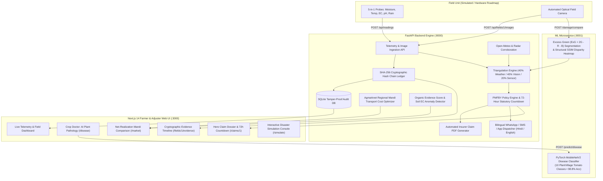

# FasalSakshi (फसलसाक्षी) 🌾
### Automated Crop Evidence Vault, PMFBY Claim Dossier & Market Realization Engine

> **One-Line Pitch:** A field intelligence layer that watches a farmer's crop daily, builds an immutable SHA-256 cryptographic evidence chain of ground reality, automates PMFBY insurance claims within statutory 72-hour deadlines, provides real-time AI Crop Doctor pathology diagnostics, and unlocks premium market realization with mandi transport routing.

[](https://github.com/preyanshw29/CluelessCoders_HackShift)
[](LICENSE)
[](https://pytorch.org)
[](https://fastapi.tiangolo.com)
[](https://nextjs.org)

---

## 📌 Honest Engineering Framing (Judges & Evaluation)

To maintain complete integrity and transparency during hackathon evaluation, our boundaries are explicitly defined:

| Category | Component & Scope |
|---|---|
| **Built (Real & Live)** | • **Next.js 14 Web Application** with bilingual English/Hindi interface.<br>• **Crop Doctor AI**: Real PyTorch MobileNetV2 edge model (98.8% accuracy) classifying 10 PlantVillage classes with organic Krishi Vigyan Kendra (KVK) remedies.<br>• **SHA-256 Cryptographic Evidence Vault**: Tamper-proof hash chain verifying every field photo timestamp and integrity.<br>• **Multi-Factor Triangulation Engine**: Blends 40% weather radar, 40% computer vision canopy loss (Excess Green $2G - R - B$ + SSIM), and 20% in-situ IoT telemetry.<br>• **PMFBY Policy Engine**: Automated statutory 72-hour countdown, coverage evaluation (localized perils vs area yield), and indemnity bound estimation.<br>• **Automated PDF Dossier Generator**: One-click insurer-admissible PDF compiling telemetry charts and hash audit tables.<br>• **Bilingual Alerts**: Hindi and English SMS/WhatsApp notifications with helpline 14447 guidance.<br>• **Mandi Net-Profit Logistics Optimizer**: Computes net revenue after deducting road transport costs (₹0.25/qtl/km).<br>• **Organic Practice Evidence Scorer**: Logs inputs and flags synthetic fertilizer dumping via soil EC anomaly detection. |
| **Simulated (Clearly Labelled)** | Deterministic sensor feed (Python streaming CLI + dashboard scenario triggers) and calibrated weather profiles to guarantee reliable, repeatable disaster testing during live demos. |
| **Roadmap (Designed, Not Built)** | Physical ruggedized field unit: solar panel, optical camera, and 5-in-1 soil probe (moisture, temp, EC, pH, rain).<br>*Defensibility: Off-the-shelf sensors are a commodity; the true proprietary value lies in the data integrity ledger, multi-signal evidence synthesis, and automated claims pipeline.* |

> **Legal & Advisory Notes:**
> 1. **Organic Score:** Represents "evidence strength from logged practices and sensor corroboration", **not** government NPOP / PGS-India statutory certification.
> 2. **Claim Payout Estimates:** Indicative bounds based on standard PMFBY guidelines; final indemnities are determined by the designated insurance company and state government notifications.
> 3. **Model Accuracy:** Trained on 10 Solanaceous tomato disease classes; performance on uncalibrated third-party field photos may vary compared to controlled camera feeds.

---

## 🏗️ System Architecture & Workflow



---

## 💻 Frontend Views & Navigation (:3000)

| Route | Page Name | Primary Interactive Features |
|---|---|---|
| `/` | **Farmer Dashboard** | North Plot summary, active sensor widgets, PMFBY policy overview, recent disaster alerts. |
| `/fields/1` | **Live Sensor Telemetry** | Animated Recharts curves for moisture, temp, humidity, rainfall, EC, and pH (5s polling). |
| `/fields/1/evidence` | **Evidence Ledger Vault** | Vertical cryptographic timeline of photos, role badges, truncated SHA-256 hashes, and Chain Verified badge. |
| `/claims/1` | **Hero Claim Dossier** | 3-bar confidence breakdown, 72h statutory countdown timer, estimated payout range, and one-click PDF download. |
| `/market` | **Mandi Intelligence** | Regional mandi profit ranking with freight deduction (₹0.25/qtl/km), plus 0–100 Organic Trust Score gauge. |
| `/simulate` | **Disaster Console** | 1-click calamity trigger buttons (`hail`, `flood`, `drought`, `frost`, `fertilizer_spike`) and WhatsApp alert mockup. |
| `/disease` | **Crop Doctor AI** | Photo upload or 1-click sample leaf presets diagnosing plant disease with confidence gauges and KVK treatment advice. |

---

## 🚀 Quick Start Guide

### Prerequisites
- **Python 3.11+** installed and available
- **Node.js 18+ / 20+** and `npm`

---

### Option 1: 1-Click Launch (Windows — Recommended)
Double-click or run from PowerShell / Command Prompt in the repository root:
```cmd
.\scripts\run_all.bat
```
*(Or in PowerShell: `powershell -ExecutionPolicy Bypass -File .\scripts\run_all.ps1`)*

This automatically spins up all three services in separate, dedicated terminal windows:
- **ML Microservice:** [http://localhost:8001](http://localhost:8001) (API Docs: `/docs`)
- **Backend API:** [http://localhost:8000](http://localhost:8000) (Swagger Docs: `/docs`)
- **Next.js Web UI:** [http://localhost:3000](http://localhost:3000)

---

### Option 2: Manual Terminal Launch

#### Terminal 1 — ML Microservice (Port 8001)
```powershell
cd ml-service
.\venv\Scripts\python.exe run.py
```

#### Terminal 2 — FastAPI Backend (Port 8000)
```powershell
cd backend
.\venv\Scripts\python.exe -m uvicorn app.main:app --port 8000 --reload
```

#### Terminal 3 — Next.js Frontend (Port 3000)
```powershell
cd frontend-simulation\frontend
npm run dev
```

---

## 🧪 Verification & Automated Test Suites

The codebase includes end-to-end verification covering unit tests, neural inference, and integration:

```powershell
# 1. Run Backend Policy Engine & PDF Generator Tests (14 passed)
backend\venv\Scripts\pytest.exe backend/tests

# 2. Run ML Microservice Computer Vision Tests (5 passed)
ml-service\venv\Scripts\pytest.exe ml-service/tests

# 3. Run End-to-End System Smoke Test (9/9 passed)
backend\venv\Scripts\python.exe scripts/smoke_test.py
```

---

## 📡 API Reference Overview

### ML Microservice (`:8001`)
| Method | Path | Description |
|---|---|---|
| `GET` | `/health` | Service health status and active model checkpoint registry |
| `POST` | `/predict/disease` | MobileNetV2 tomato pathology classification with top-3 ranking |
| `POST` | `/damage/compare` | Excess Green ($2G - R - B$) canopy segmentation and SSIM differential heatmap |

### Backend API (`:8000`)
| Method | Path | Description |
|---|---|---|
| `GET` | `/api/health` | Backend status & SQLite database connectivity |
| `GET` | `/api/fields/{id}` | Farmer profile and field cadastral metadata |
| `POST` | `/api/readings` | Stream in-situ IoT soil and meteorological telemetry |
| `POST` | `/api/simulate/{peril}` | Trigger calamity simulation (`hail`, `flood`, `drought`, `frost`, `fertilizer_spike`) |
| `GET` | `/api/fields/{id}/chain/verify` | Verify cryptographic SHA-256 hash chain validity |
| `GET` | `/api/claims/{id}/report.pdf` | Download official insurer-ready PDF claim dossier |
| `GET` | `/api/market/best` | Rank regional mandis by net profit after transport |
| `GET` | `/api/fields/{id}/trust-score` | Calculate Organic Evidence Score (0–100) with anomaly deductions |

---

## 👥 Team & Ownership Matrix (HackShift: CluelessCoders)

Strictly structured according to the team ownership contract in [`plan.md`](plan.md):

| Member | Role | Owned Directories & Files |
|---|---|---|
| **Member 1 (M1)** | ML Engineer | `ml/`, `ml-service/`, `demo_assets/` — MobileNetV2 disease model, ExG canopy segmentation, SSIM heatmap generator. |
| **Member 2 (M2)** | Backend & Policy Engine | `backend/schema.sql`, `backend/app/{main,db,seed,hashchain,weather,policy_engine,scoring,pipeline}.py`, `contracts/`, `scripts/`. |
| **Member 3 (M3)** | Frontend & Sensor Simulator | `frontend/`, `frontend-simulation/`, `simulator/` — Next.js 14 App Router, Recharts telemetry, bilingual i18n, simulator CLI. |
| **Member 4 (M4)** | Reporting, Alerts & Market | `backend/app/{report,alerts,market,seed_organic}.py`, `mandi_prices.csv`, `backend/tests/test_m4.py`, `docs/`, `README.md`. |

---

## 📄 Documentation Links
* [3-Minute Timed Demonstration Script](docs/demo_script.md)
* [Judge Q&A & Technical Defense Guide](docs/judge_qa.md)
* [REST API Reference & Contract Specification](docs/api_reference.md)
* [Pitch Presentation Outline & Deck Structure](docs/pitch_outline.md)
